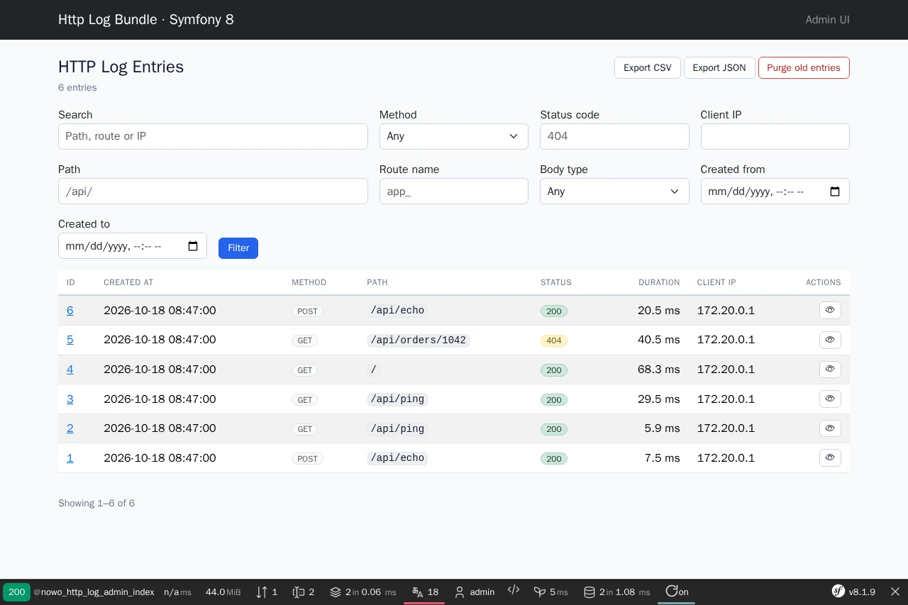
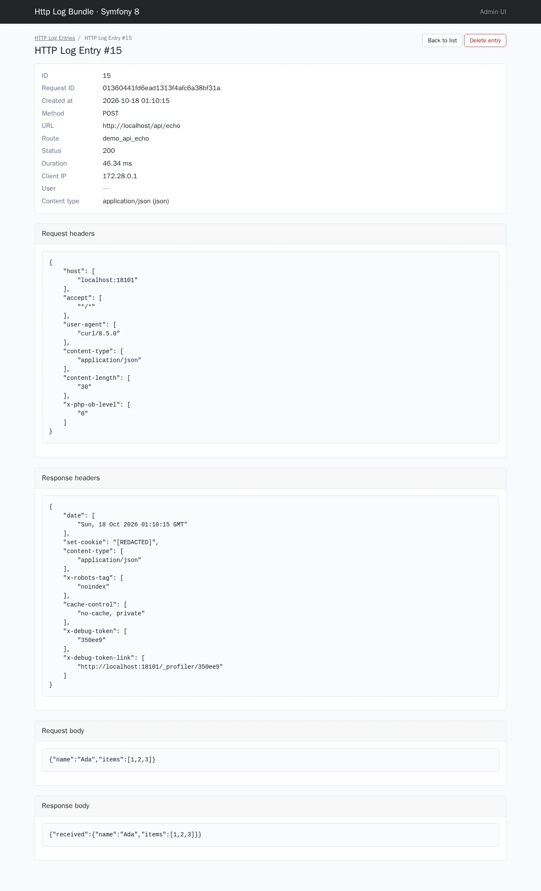

# Usage

How to capture HTTP traffic, use the admin UI, export, purge, and exclude routes.

## Table of contents

- [Automatic capture](#automatic-capture)
- [Body storage policy](#body-storage-policy)
- [Redaction](#redaction)
- [Admin UI](#admin-ui)
- [Twig template overrides](#twig-template-overrides)
- [Customising the admin pages](#customising-the-admin-pages)
- [Translation overrides](#translation-overrides)
- [Export](#export)
- [Purge and retention](#purge-and-retention)
- [Ignoring routes and paths](#ignoring-routes-and-paths)
- [CLI commands](#cli-commands)
- [Async processing](#async-processing)

## Automatic capture

Once installed and enabled, the bundle registers `HttpLogSubscriber` on:

- `kernel.request` — records start time and request id (`X-Request-Id` header or generated UUID).
- `kernel.terminate` — builds the log entry and persists (sync or async).

Each stored row includes method, path, route name, status code, duration (ms), client IP, user identifier, headers, and optional bodies.

Disable globally:

```yaml
nowo_http_log:
    enabled: false
```

Restrict to specific environments:

```yaml
nowo_http_log:
    environments: [prod, staging]
```

Sample traffic:

```yaml
nowo_http_log:
    sampling_rate: 0.25
```

## Body storage policy

Request bodies are **off by default**. Enable explicitly:

```yaml
nowo_http_log:
    capture:
        request_body: true
        max_body_bytes: 32768
```

Response bodies are stored per content type:

```yaml
nowo_http_log:
    capture:
        response_body_by_type:
            json: true
            html: false
            binary: false
```

Classification uses the `Content-Type` header and body sniffing for SOAP, JSON, HTML, and XML when the header is missing.

## Redaction

Sensitive data is redacted before storage. Customize lists in [CONFIGURATION.md](CONFIGURATION.md#redaction).

Example — redact `Authorization` and JSON `*.secret`:

```yaml
nowo_http_log:
    redaction:
        headers:
            - Authorization
        json_paths:
            - '*.secret'
```

Redacted values appear as `[REDACTED]`.

## Admin UI

Default URL: **`/admin/http-log`** (configurable via `web_ui.path_prefix`).

Features:

- Paginated list with filters (method, status, route, date range, free text) — UiKit list scaffold
- Detail view with headers and bodies — UiKit show scaffold
- Export and purge actions (subject to access checker; hidden from users who may not use them); purge and delete
  confirm in the UiKit dialog

| List | Entry |
| --- | --- |
|  |  |

More: [filtered list](images/demo/admin-list-filtered.webp) · [delete confirm](images/demo/admin-delete-confirm.webp) ·
[mobile list](images/demo/admin-list-mobile.webp).

Access requires Symfony Security unless `security.allow_unauthenticated: true`. Default roles: `ROLE_ADMIN` (REQ-UI-002).

Custom access logic — implement `HttpLogAccessCheckerInterface` and set:

```yaml
nowo_http_log:
    security:
        access_checker: App\Security\MyHttpLogAccessChecker
```

## Twig template overrides

Since **1.8** the admin pages follow the UiKit 2.0 page contract (REQ-UI-003): `admin/index.html.twig` extends the
UiKit **list** scaffold and `admin/show.html.twig` the **show** scaffold. Header, breadcrumbs, flashes, filter row,
table frame, row actions, confirm dialogs, pagination and empty state come from UiKit; the bundle templates fill only
data blocks. Full list: [TEMPLATES.md](TEMPLATES.md).

Application templates under `templates/bundles/NowoHttpLogBundle/` **always win** over the bundle copy for the same
relative path (REQ-TWIG-001), and the originals stay reachable as `@!NowoHttpLogBundle/…`. **Freeze rule:** once you
copy a template into your app, that path is frozen — vendor updates to the same file will not apply until you delete
or merge your override. Prefer, in this order:

1. **Theme** — `nowo_ui_kit.theme` (once for every bundle) or `nowo_ui_kit.theme.bundles.NowoHttpLogBundle`
   (classes, attributes, partials, tokens for this bundle only). See UiKit `docs/THEME_SLOTS.md`.
2. **Layout** — `nowo_ui_kit.layouts.admin` (every bundle) or `nowo_http_log.web_ui.layout_template` (this bundle).
3. **Thin page override** — `web_ui.templates.index|show` pointing at a template that extends
   `@!NowoHttpLogBundle/admin/<page>.html.twig` and overrides one data block.
4. **Scaffold override** — `templates/bundles/NowoUiKitBundle/page/list.html.twig` re-skins every bundle list.

| Subpath | Purpose |
| --- | --- |
| `admin/index.html.twig` | Log list (`page/list`, data block `nowo_ui_list_row`) |
| `admin/show.html.twig` | Entry detail (`page/show`, payload blocks `nowo_http_log_section_*` in `nowo_ui_show_after`) |
| `admin/_filter.html.twig` | **Deprecated** (removed in 2.0): BC partial for `web_ui.templates.filter` overrides |

Export, purge and delete post the flat `_token` field with the CSRF token ids `http_log_export`, `http_log_purge`
and `http_log_delete`; export carries `format` and the active criteria in its URL query.

## Customising the admin pages

**Row cells.** Override `nowo_ui_list_row` (context: `row` = `HttpLogEntry`, `row_key`, `loop`, `page`). Cells use
`nowo_ui_class('table_cell', page.bundle)` and keep `data-label` (card mode of responsive lists):

```twig
{# templates/admin/http_log/index.html.twig — nowo_http_log.web_ui.templates.index #}



    <p class="{{ nowo_ui_class('muted', page.bundle) }}">{{ 'admin.index.total'|trans({'%count%': page.pagination.total}, 'NowoHttpLogBundle') }}</p>

```

**Payload sections.** `admin/show.html.twig` renders query parameters, headers and bodies as cards in
`nowo_ui_show_after`, one block each: `nowo_http_log_section_query_params`, `_request_headers`, `_response_headers`,
`_request_body`, `_response_body` (context: `entry`, `page`). Override one with an empty block to hide it.

**Filter row.** Field widths come from `ListPage::filterFields`; restyle through the `filters`, `filters_field` and
`filters_actions` slots, or override the `nowo_ui_list_filters` block in a page override. The 1.x hooks still work
until 2.0: `web_ui.templates.filter` is bridged to the bundle theme partial `list_filters`, and its template may extend
`@!NowoHttpLogBundle/admin/_filter.html.twig` and override `nowo_http_log_filter_panel` (whole region, `filterForm` =
`page.filters`) or `nowo_http_log_filter_fields` / `nowo_http_log_filter_actions` (form with the UiKit filter slots;
remaining fields render through `form_end`).

**Pagination.** The UiKit pagination keeps the filters (`http_log_filter[...]`) and sort of the current query across
pages. `web_ui.templates.pagination` (deprecated) is bridged to the bundle theme partial `pagination` and receives the
UiKit input (`pagination` = `{page, per_page, total, total_pages, …}`, `pagination_model`, `item_count`, `route`,
`route_params`, `query`); the 1.x extras `pages`, `page_size`, `nav_label`, `nav_trans_domain` and `framework` are no
longer passed.

### Example: Symfony Beacon

With 1.8 Beacon deletes its HttpLog page forks and the chrome block of `nowo_http_log.yaml`: its UiKit layout bridge
(`nowo_ui_kit.layouts.admin`) and theme (`nowo_ui_kit.theme`, Tailwind classes per slot) already style every
scaffold. Keys it no longer needs: `ui_kit_stylesheet`, `header_actions_in_layout` (header actions are in the page
header), `confirm_attributes` (UiKit confirm dialog), `ui_kit_row_actions`, `css_classes`, `attributes` (use
`theme.bundles.NowoHttpLogBundle` for the few HttpLog-only differences, e.g. `classes.table`), `templates.pagination`
(its `kit/_pagination.html.twig` becomes `theme.partials.pagination` for every bundle). Its product filter partial can
stay as `theme.bundles.NowoHttpLogBundle.partials.list_filters` (or `web_ui.templates.filter` until 2.0).

## Translation overrides

Symfony loads application catalogues **before** bundle fallbacks (REQ-I18N-001).

- **Domain:** `NowoHttpLogBundle` (use this in PHP `->trans(..., domain: 'NowoHttpLogBundle')` and Twig `|trans({}, 'NowoHttpLogBundle')`).
- **Override path:** `translations/NowoHttpLogBundle.<locale>.yaml` in your app (e.g. `translations/NowoHttpLogBundle.en.yaml`).
- **Behaviour:** keys defined in the app file replace bundle strings; missing keys fall back to the bundle catalogue.

**Shipped locales:** `en`, `es`, `fr`, `de`, `it`, `nl`, `pt`.

Example — customise the admin title in English:

```yaml
# translations/NowoHttpLogBundle.en.yaml
admin.title: Request audit log
```

## Export

**Admin UI:** use the export button on the filtered list (CSV or JSON, up to `export.max_sync_rows`).

**CLI:**

```bash
php bin/console nowo:http-log:export --format=csv --output=/tmp/http-log.csv
php bin/console nowo:http-log:export --format=json
```

Large exports can be dispatched asynchronously via `ExportHttpLogMessage` when Messenger is configured.

## Purge and retention

**Retention** (`retention.days`) defines how old entries may be when purging. `null` keeps all rows until manual purge.

**CLI:**

```bash
php bin/console nowo:http-log:purge
php bin/console nowo:http-log:purge --dry-run
```

**Admin UI:** purge action on the index page (requires purge permission from access checker).

Async purge uses `PurgeHttpLogMessage`.

Every purge deletes in batches of `retention.purge_batch_size` rows (default `1000`, keyset on the id), so purging
a large table does not hold one long lock or write one huge binlog event. The returned / printed count is the total
number of rows deleted.

## Ignoring routes and paths

Skip profiler, admin, or internal routes:

```yaml
nowo_http_log:
    ignore_routes:
        - '_wdt'
        - '_profiler'
        - 'api_health_*'
    ignore_path_prefixes:
        - '/admin/http-log'
        - '/internal'
```

Route patterns use `fnmatch` (case-insensitive). The admin UI path is ignored by default so browsing logs does not flood the table.

Kit-internal requests are skipped as well while `ignore_default_path_prefixes` is `true` (default): `/_nowo/`
(HotReloadBundle client and shared worker), `/sw.js` and `/manifest.webmanifest` (PwaBundle). They are merged with your
`ignore_path_prefixes`, so you do not need to list them; set `ignore_default_path_prefixes: false` to record them.

## CLI commands

| Command | Description |
| --- | --- |
| `nowo:http-log:export` | Export entries to CSV or JSON |
| `nowo:http-log:purge` | Delete entries older than retention |

Run `php bin/console list nowo:http-log` for options.

## Async processing

With `async: true` (default), capture dispatches `PersistHttpLogMessage`. Run a worker:

```bash
php bin/console messenger:consume async -vv
```

Set `async: false` to persist in the same request (after response sent, on terminate).

Configure **retries** and a **failure transport** for production async setups — see [CONFIGURATION.md](CONFIGURATION.md#messenger-retry-and-failure-transport).

## FrankenPHP worker mode

Safe under FrankenPHP worker with **no kernel reset** between requests: detach after persist, reset closed EntityManagers, firewall-gated user capture. See [FRANKENPHP-WORKER-AUDIT.md](FRANKENPHP-WORKER-AUDIT.md) and [DEMO-FRANKENPHP.md](DEMO-FRANKENPHP.md#worker-mode-without-kernel-reset).

See [INSTALLATION.md](INSTALLATION.md) and [CONFIGURATION.md](CONFIGURATION.md).
