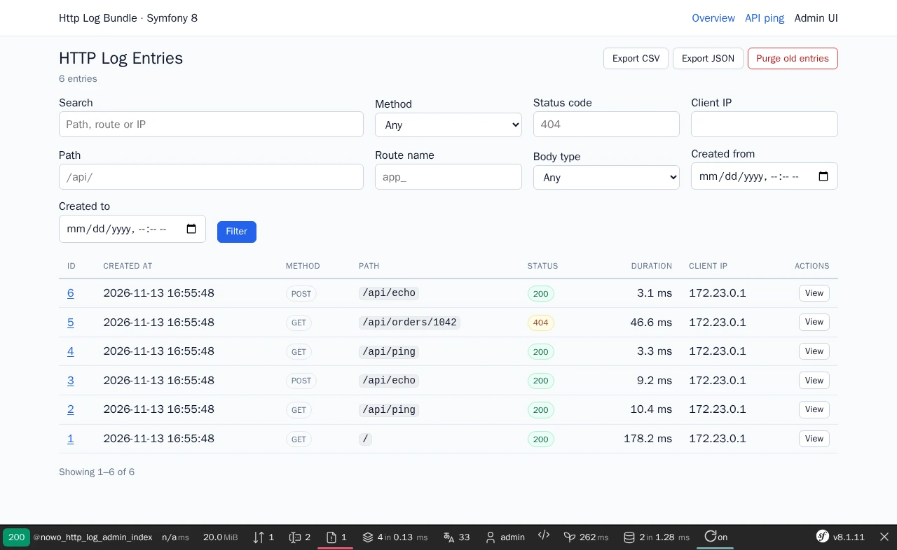
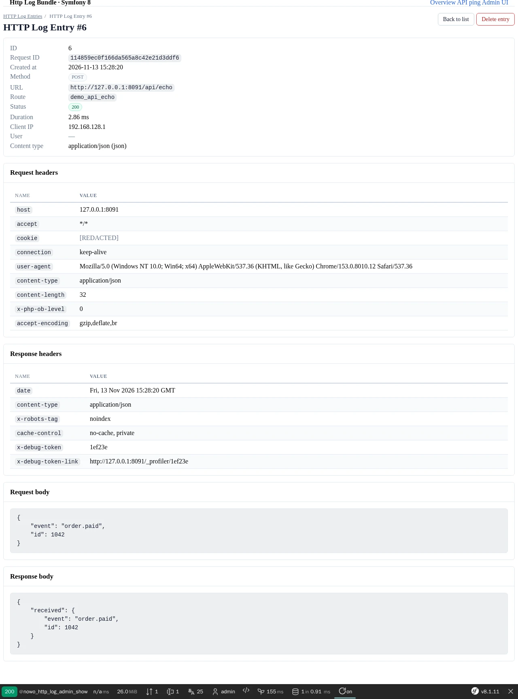

# Usage

How to capture HTTP traffic, use the admin UI, export, purge, and exclude routes.

## Table of contents

- [Automatic capture](#automatic-capture)
- [Body storage policy](#body-storage-policy)
- [Redaction](#redaction)
- [Admin UI](#admin-ui)
- [Twig template overrides](#twig-template-overrides)
- [Customising the admin pages](#customising-the-admin-pages)
  - [Example: Symfony Beacon](#example-symfony-beacon)
- [Translation overrides](#translation-overrides)
- [Export](#export)
- [Purge and retention](#purge-and-retention)
- [Personal-data erasure (GDPR)](#personal-data-erasure-gdpr)
- [Outbound and mailer usage](#outbound-and-mailer-usage)
  - [Outbound HttpClient calls](#outbound-httpclient-calls)
  - [Mails](#mails)
  - [Tenant and project context](#tenant-and-project-context)
- [Named inbound channels](#named-inbound-channels)
  - [Credential and tenant resolver](#credential-and-tenant-resolver)
- [Daily rollup and read API](#daily-rollup-and-read-api)
  - [Backfill](#backfill)
- [Usage erasure (credentials, tenants)](#usage-erasure-credentials-tenants)
- [Ignoring routes and paths](#ignoring-routes-and-paths)
- [CLI commands](#cli-commands)
- [Async processing](#async-processing)
- [FrankenPHP worker mode](#frankenphp-worker-mode)

## Automatic capture

Once installed and enabled, the bundle registers `HttpLogSubscriber` on:

- `kernel.request` — records start time and a bundle-generated request id (random hex, the row's dedupe key; a client `X-Request-Id` is never used for it and stays only in the captured request headers).
- `kernel.terminate` — builds the log entry and persists (sync or async).

Each stored row includes method, path, route name, status code, duration (ms), client IP, user identifier, headers, and optional bodies.

Disable globally:

```yaml
nowo_http_log:
    enabled: false
```

Restrict to specific environments:

```yaml
nowo_http_log:
    environments: [prod, staging]
```

Sample traffic:

```yaml
nowo_http_log:
    sampling_rate: 0.25
```

## Body storage policy

Request bodies are **off by default**. Enable explicitly:

```yaml
nowo_http_log:
    capture:
        request_body: true
        max_body_bytes: 32768
```

Response bodies are stored per content type:

```yaml
nowo_http_log:
    capture:
        response_body_by_type:
            json: true
            html: false
            binary: false
```

Classification uses the `Content-Type` header and body sniffing for SOAP, JSON, HTML, and XML when the header is missing.

## Redaction

Sensitive data is redacted before storage. Customize lists in [CONFIGURATION.md](CONFIGURATION.md#redaction).

Example — redact `Authorization` and JSON `*.secret`:

```yaml
nowo_http_log:
    redaction:
        headers:
            - Authorization
        json_paths:
            - '*.secret'
```

Redacted values appear as `[REDACTED]`.

## Admin UI

Default URL: **`/admin/http-log`** (configurable via `web_ui.path_prefix`).

Features:

- Paginated list with filters (method, status, route, date range, free text) — UiKit list scaffold
- Detail view with headers and bodies — UiKit show scaffold
- Export and purge actions (subject to access checker; hidden from users who may not use them); purge and delete
  confirm in the UiKit dialog

| List | Entry |
| --- | --- |
|  |  |

More: [delete confirm](images/demo/admin-delete-confirm.webp).

Access requires Symfony Security unless `security.allow_unauthenticated: true`. Default roles: `ROLE_ADMIN` (REQ-UI-002).

Custom access logic — implement `HttpLogAccessCheckerInterface` and set:

```yaml
nowo_http_log:
    security:
        access_checker: App\Security\MyHttpLogAccessChecker
```

## Twig template overrides

Since **1.8** the admin pages follow the UiKit 2.1 page contract (REQ-UI-003): `admin/index.html.twig` extends the
UiKit **list** scaffold and `admin/show.html.twig` the **show** scaffold. Header, breadcrumbs, flashes, filter row,
table frame, row actions, confirm dialogs, pagination and empty state come from UiKit; the bundle templates fill only
data blocks. Full list: [TEMPLATES.md](TEMPLATES.md).

Application templates under `templates/bundles/NowoHttpLogBundle/` **always win** over the bundle copy for the same
relative path (REQ-TWIG-001), and the originals stay reachable as `@!NowoHttpLogBundle/…`. **Freeze rule:** once you
copy a template into your app, that path is frozen — vendor updates to the same file will not apply until you delete
or merge your override. Prefer, in this order:

1. **Theme** — `nowo_ui_kit.theme` (once for every bundle) or `nowo_ui_kit.theme.bundles.NowoHttpLogBundle`
   (classes, attributes, partials, tokens for this bundle only). See UiKit `docs/THEME_SLOTS.md`.
2. **Layout** — `nowo_ui_kit.layouts.admin` (every bundle) or `nowo_http_log.web_ui.layout_template` (this bundle).
3. **Thin page override** — `web_ui.templates.index|show` pointing at a template that extends
   `@!NowoHttpLogBundle/admin/<page>.html.twig` and overrides one data block.
4. **Scaffold override** — `templates/bundles/NowoUiKitBundle/page/list.html.twig` re-skins every bundle list.

| Subpath | Purpose |
| --- | --- |
| `admin/index.html.twig` | Log list (`page/list`, data block `nowo_ui_list_row`) |
| `admin/show.html.twig` | Entry detail (`page/show`, payload blocks `nowo_http_log_section_*` in `nowo_ui_show_after`) |
| `admin/_filter.html.twig` | **Deprecated** (removed in 2.0): BC partial for `web_ui.templates.filter` overrides |

Export, purge and delete are `FormView`-backed UiKit actions: they post the flat `_token` field with the CSRF token
ids `http_log_export`, `http_log_purge` and `http_log_delete`; export also posts `format` and the active criteria as
hidden fields (UiKit 2.1 prints them on every render, also through a host `page_header` override). Every admin form
(filter and the three actions) is a FormKit Type bound to the `http_log` profile (REQ-TWIG-005 rule 11, see
[CONFIGURATION](CONFIGURATION.md#form-profile-formkit)).

## Customising the admin pages

**Row cells.** Override `nowo_ui_list_row` (context: `row` = `HttpLogEntry`, `row_key`, `loop`, `page`). Cells use
`nowo_ui_class('table_cell', page.bundle)` and keep `data-label` (card mode of responsive lists):

```twig
{# templates/admin/http_log/index.html.twig — nowo_http_log.web_ui.templates.index #}



    <p class="{{ nowo_ui_class('muted', page.bundle) }}">{{ 'admin.index.total'|trans({'%count%': page.pagination.total}, 'NowoHttpLogBundle') }}</p>

```

**Payload sections.** `admin/show.html.twig` renders query parameters, headers and bodies as cards in
`nowo_ui_show_after`, one block each: `nowo_http_log_section_query_params`, `_request_headers`, `_response_headers`,
`_request_body`, `_response_body` (context: `entry`, `page`). Override one with an empty block to hide it. The `<pre>`
blocks use the UiKit `code_block` slot (restyle with `nowo_ui_kit.theme.bundles.NowoHttpLogBundle.classes.code_block`
or the `--nowo-ui-code-*` tokens) and keep the class `nowo-http-log-code`.

**Filter row.** Field widths come from `ListPage::filterFields`; restyle through the `filters`, `filters_field` and
`filters_actions` slots, or override the `nowo_ui_list_filters` block in a page override. The 1.x hooks still work
until 2.0: `web_ui.templates.filter` is bridged to the bundle theme partial `list_filters`, and its template may extend
`@!NowoHttpLogBundle/admin/_filter.html.twig` and override `nowo_http_log_filter_panel` (whole region, `filterForm` =
`page.filters`) or `nowo_http_log_filter_fields` / `nowo_http_log_filter_actions` (form with the UiKit filter slots;
remaining fields render through `form_end`).

**Pagination.** The UiKit pagination keeps the filters (`http_log_filter[...]`) and sort of the current query across
pages. `web_ui.templates.pagination` (deprecated) is bridged to the bundle theme partial `pagination` and receives the
UiKit input (`pagination` = `{page, per_page, total, total_pages, …}`, `pagination_model`, `item_count`, `route`,
`route_params`, `query`); the 1.x extras `pages`, `page_size`, `nav_label`, `nav_trans_domain` and `framework` are no
longer passed.

### Example: Symfony Beacon

With 1.8 Beacon deletes its HttpLog page forks and the chrome block of `nowo_http_log.yaml`: its UiKit layout bridge
(`nowo_ui_kit.layouts.admin`) and theme (`nowo_ui_kit.theme`, Tailwind classes per slot) already style every
scaffold. Keys it no longer needs: `ui_kit_stylesheet`, `header_actions_in_layout` (header actions are in the page
header), `confirm_attributes` (UiKit confirm dialog), `ui_kit_row_actions`, `css_classes`, `attributes` (use
`theme.bundles.NowoHttpLogBundle` for the few HttpLog-only differences, e.g. `classes.table`), `templates.pagination`
(its `kit/_pagination.html.twig` becomes `theme.partials.pagination` for every bundle). Its product filter partial can
stay as `theme.bundles.NowoHttpLogBundle.partials.list_filters` (or `web_ui.templates.filter` until 2.0).

## Translation overrides

Symfony loads application catalogues **before** bundle fallbacks (REQ-I18N-001).

- **Domain:** `NowoHttpLogBundle` (use this in PHP `->trans(..., domain: 'NowoHttpLogBundle')` and Twig `|trans({}, 'NowoHttpLogBundle')`).
- **Override path:** `translations/NowoHttpLogBundle.<locale>.yaml` in your app (e.g. `translations/NowoHttpLogBundle.en.yaml`).
- **Behaviour:** keys defined in the app file replace bundle strings; missing keys fall back to the bundle catalogue.

**Shipped locales:** `en`, `es`, `fr`, `de`, `it`, `nl`, `pt`.

Example — customise the admin title in English:

```yaml
# translations/NowoHttpLogBundle.en.yaml
admin.title: Request audit log
```

## Export

**Admin UI:** use the export button on the filtered list (CSV or JSON). Up to `export.max_sync_rows` rows the file is downloaded at once; larger exports are queued on Messenger, written to `export.directory` and offered as **Download … export** buttons in the list header (users allowed to export only) until `export.ttl_hours` expires.

**CLI:**

```bash
php bin/console nowo:http-log:export --format=csv --output=/tmp/http-log.csv
php bin/console nowo:http-log:export --format=json
```

Large exports can be dispatched asynchronously via `ExportHttpLogMessage` when Messenger is configured.

## Purge and retention

**Retention** (`retention.days`) defines how old entries may be when purging. `null` keeps all rows until manual purge.

**CLI:**

```bash
php bin/console nowo:http-log:purge
php bin/console nowo:http-log:purge --dry-run
```

**Admin UI:** purge action on the index page (requires purge permission from access checker).

Async purge uses `PurgeHttpLogMessage`.

With outbound or mailer capture enabled, the retention runs **per scope**: `web` rows (no channel) by
`retention.days`, `outbound` and `mailer` rows by their own `retention_days`, one output line per scope:

```bash
php bin/console nowo:http-log:purge                       # every scope, its own retention
php bin/console nowo:http-log:purge --channel=outbound    # one scope (repeatable)
php bin/console nowo:http-log:purge --channel=web --days=7
php bin/console nowo:http-log:purge --days=7              # 1.14 meaning: every row of every channel
```

Named channels are scopes too (`--channel=api`, their `retention_days`). With the [rollup](#daily-rollup-and-read-api)
enabled, the command (and `PurgeHttpLogMessage` without arguments) also purges the `rollup` buckets older than
`rollup.retention_months` calendar months (13 keeps the same month last year) and the `ledger` older than
`rollup.dedupe_days`; `--channel=rollup --days=90` keeps the last 90 days of buckets (never fewer than the current
month). A bare `--days` never touches
the rollup, and neither does the admin purge form.

Every purge deletes in batches of `retention.purge_batch_size` rows (default `1000`, keyset on the id), so purging
a large table does not hold one long lock or write one huge binlog event. The returned / printed count is the total
number of rows deleted.

## Personal-data erasure (GDPR)

Do not run SQL on the bundle table: its name depends on `doctrine.table_name_prefix` / `doctrine.table_prefix`. Inject
the public service `Nowo\HttpLogBundle\Privacy\HttpLogPersonalDataEraserInterface` (since Unreleased):

| Method | Matches |
|---|---|
| `countByUserIdentifier(string $userIdentifier): int` / `deleteByUserIdentifier(...)` | `user_identifier` (exact; `UserInterface::getUserIdentifier()` at request time) |
| `countByClientIp(string $clientIp): int` / `deleteByClientIp(...)` | `client_ip` (exact) |

Matching is **exact, byte for byte**, whatever the database collation: the SQL `=` only pre-filters (a MySQL utf8mb4
`*_ci` collation would also return `ANA`, `Ana`, `ána` for `ana`, or `ß` for `ss`) and every candidate is compared with
`===` in PHP, so erasing one user never deletes another user's entries. IP addresses are compared **as logged, without
normalisation**: pass the textual form `Request::getClientIp()` returned (`fe80::a` does not match `FE80::A` or
`fe80:0:0:0:0:0:0:a`). Deletes run in keyset batches of `retention.purge_batch_size` rows and return the number of
entries deleted; an empty value or one containing a NUL byte (PDO would cut it there) throws
`InvalidArgumentException`. Only these two identifier columns are matched: personal data a third
party sent in a body, header or query string of their own entries is not searched (redaction keeps most of it out).

```php
use Nowo\HttpLogBundle\Privacy\HttpLogPersonalDataEraserInterface;

final class RequestLogsEraser
{
    public function __construct(private HttpLogPersonalDataEraserInterface $httpLog) {}

    public function erase(string $userIdentifier): int
    {
        return $this->httpLog->deleteByUserIdentifier($userIdentifier);
    }
}
```

If a host still needs SQL (reports), take the physical name from the container parameter
`%nowo_http_log.doctrine.entry_table%`.

## Outbound and mailer usage

Opt-in (`outbound.enabled`, `mailer.enabled`): one row per outbound HttpClient call (channel `outbound`) or per mail
send attempt (channel `mailer`), next to the web rows (channel NULL). Usage rows are an **allowlist**: method, scheme,
host, a path template, provider, status, error kind, duration, response size, retries, content type, tenant,
project, Messenger message id and the mail Message-ID. Never headers, bodies, query strings, user info, addresses,
subjects or exception messages.

Rows are buffered and written after the response is sent, after a command and after each worker message, so logging
adds no query to a request and a host transaction that rolls back keeps the log of its failed call. A logging failure
logs one warning (exception class only) on the `nowo_http_log` channel and drops that capture: it never breaks the
call, the mail or the request.

With a block enabled the admin list gains channel / provider columns and filters (channel, provider, tenant, project,
credential kind), and an access checker that also implements `HttpLogChannelAccessCheckerInterface` can hide
channels:

```php
final class AppHttpLogAccessChecker implements HttpLogAccessCheckerInterface, HttpLogChannelAccessCheckerInterface
{
    // canAccessAdmin(), canExport(), canPurge() …

    public function canViewChannel(?object $user, string $channel): bool
    {
        return $channel !== 'mailer' || $this->security->isGranted('ROLE_SUPPORT');
    }
}
```

### Outbound HttpClient calls

`outbound.enabled` decorates `http_client` and every scoped client (`outbound.clients`) as the **outermost**
decorator: a call retried by `RetryableHttpClient` is one row with its `retry_count`; tracing decorators are not
affected. The decorator returns the inner client's response unchanged (same status, headers, body, chunks, exceptions;
still lazy) and never reads or buffers the body. The row is recorded once, when the response completes, fails, is
cancelled or destroyed:

| Column | Outbound value |
| --- | --- |
| `host` | lower-cased host (IDN as punycode), port only when not the default; never user info |
| `host` | stored as is: when the host name itself is the secret (per-endpoint request-bin style hosts), list it in `outbound.exclude_hosts` |
| `path` | path template: a provider template, else up to `path_depth` segments, each kept only when it is a version (`v2`) or a known path word (built-in REST words such as `api`, `users`, `files`, plus `outbound.path_words`), else `{uuid}`, `{id}`, `{seg}` (any other word: it may be a webhook key or a topic name) or `{x}`; the rest `/{…}`. Query string and fragment are dropped. Webhook hosts should use `path_depth: 0` |
| `status_code` / `error_kind` | final status; `timeout`, `dns`, `connect`, `tls`, `transport`, `redirect_limit`, `cancelled`, `http_4xx`, `http_5xx`, `exception` (no status for transport errors). Exception messages are never stored: they contain the full URL |
| `retry_count`, `response_bytes`, `content_type`, `duration_ms` | from the response info |
| `tenant_key`, `project_key`, `messenger_message_id` | from `HttpLogContext` at request time, or the request option below |

Per-request options (removed before the inner client sees the request):

```php
$client->request('GET', $url, ['extra' => ['nowo_http_log' => [
    'tenant_key'  => $organization->getUuid(),
    'project_key' => $project->getUuid(),
    'provider'    => 'clickup',   // only a configured provider
    'skip'        => true,        // no row for this call
]]]);
```

Clients built in code (not container services) are wrapped explicitly; with outbound disabled `wrap()` returns the
client unchanged, and a wrapped client is never wrapped twice:

```php
use Nowo\HttpLogBundle\HttpClient\HttpLogHttpClientWrapper;

$s3 = new S3Client($config, httpClient: $this->httpLogWrapper->wrap(HttpClient::create(), 's3'));
```

Outbound capture is suspended while the bundle itself dispatches or writes (usage rows and the web channel's own
`PersistHttpLogMessage`), so a Messenger transport or database driver that uses a decorated client cannot loop on a
write. A transport that **receives** (polls, acks) through a decorated client is not covered: list its host in
`outbound.exclude_hosts` (or `exclude_clients`), otherwise every poll becomes a row and the worker feeds itself one
message per cycle.

One `stream()` call may mix responses of several decorated clients (a scoped client and `http_client`): they are
streamed one client after the other, as the bare clients allow.

### Mails

`mailer.enabled` records one row per send attempt the Mailer transport events report (`MessageEvent`, then
`SentMessageEvent` or `FailedMessageEvent`): `method` `SEND`, `path` `/`, the transport scheme and host (never its
credentials), the provider (`mailer.providers`, else the scheme), the duration, `error_kind` (`http_4xx` / `http_5xx`
with the provider status for an `HttpTransportException`, `transport`, `exception`) and, for a sent mail, the
Message-ID without its angle brackets (`external_message_id`). Recipients, sender, subject, headers, bodies,
attachments and exception messages are never read into a row.

- A mail queued through Messenger (`SendEmailMessage`) is recorded once, when the worker sends it; with the context
  middleware on the bus it carries the tenant / project of the code that sent it and the message id.
- A failover or round-robin transport reports each attempt: one row per attempt.
- An API transport over `http_client` (Resend, Postmark…) also produces an outbound row for its HTTP call.

### Tenant and project context

Rows carry the tenant (e.g. organization UUID) and, when known, the project of the work in progress. Wrap the work
in `HttpLogContext::run()`; frames nest and are always popped:

```php
use Nowo\HttpLogBundle\Context\HttpLogContext;

$this->httpLogContext->run($organization->getUuid(), fn () => $this->sync->pull($board), $project->getUuid());
```

Add `nowo_http_log.messenger.context_middleware` to your buses ([CONFIGURATION](CONFIGURATION.md#messenger)) so a
message dispatched inside `run()` is handled inside the same tenant / project, with a stable message id stored on the
rows of its calls and mails. Tenant and project keys are opaque ids (`[A-Za-z0-9._:@-]`, at most 64 characters);
anything else is stored as NULL.

Background exports (more rows than `export.max_sync_rows`) land in one private store shared by every user allowed to
export, as in 1.14 (no per-user store). With an access checker that implements `HttpLogChannelAccessCheckerInterface`
each export remembers the channels it was built for and is listed and downloadable only by users allowed all of
them; an export made by an unrestricted user is hidden from restricted users.

## Named inbound channels

`nowo_http_log.channels` ([CONFIGURATION](CONFIGURATION.md#channels)) records requests under path prefixes or routes
as their own channel (`api`, `mcp`, `webhooks`…), with their own sampling and retention, **before** the web channel's
ignores: a host that ignores `/api` for web logging (and samples web at 25 %) still records every API error and,
with the rollup, counts every API call.

- Errors are always stored: a status >= `error_status_min` (400 by default) or an exception the kernel handled
  (`error_kind` `exception`, also for routing 404s). Successes by the channel's `sampling_rate`.
- The row stores the **route path template** (`/api/tasks/{id}`), never the raw path: a share token or an e-mail
  address in the path never reaches the table. Without a route (a 404) the path is `{unrouted}`. The map is written
  by a cache warmer to `var/cache/<env>/nowo_http_log/route_templates.php` and rebuilt in debug when a routing file
  changes; it holds the routes whose name or path template a channel selects (a route matched through a prefix its
  template does not start with, such as `/{_locale}/api/…`, needs the channel's `routes`).
- Never headers, the query string or bodies; the client IP truncated (`client_ip: truncated`, IPv4 /24, IPv6 /48);
  the server event id as `request_id` (the client's `X-Request-Id` cannot collapse or suppress rows).
- Admin list, entry page, export and purge show named channels like `outbound` / `mailer`; the channel access checker
  gets their names (`canViewChannel($user, 'api')`).

### Credential and tenant resolver

Implement `HttpLogRequestContextResolverInterface` (autoconfigured; tag `nowo_http_log.request_context_resolver`,
`priority` orders several, the first non-null answer wins) to name the credential and tenant of a request:

```php
use Nowo\HttpLogBundle\Inbound\HttpLogRequestContext;
use Nowo\HttpLogBundle\Inbound\HttpLogRequestContextResolverInterface;

final class ApiTokenUsageResolver implements HttpLogRequestContextResolverInterface
{
    public function resolve(Request $request, ?TokenInterface $token, string $channel): ?HttpLogRequestContext
    {
        $apiToken = $token?->getAttribute('api_token');   // whatever your authenticator stored
        if (!$apiToken instanceof PersonalAccessToken) {
            return null;
        }

        return new HttpLogRequestContext(
            credentialKind: 'personal_token',
            credentialId: (string) $apiToken->getId(),        // the database id, NEVER the token or its prefix
            tenantKey: $apiToken->getOrganization()->getUuid(),
            projectKey: $apiToken->getProject()?->getUuid(),
        );
    }
}
```

- It runs at most once per request: just before the controller (then the tenant / project become the request's
  `HttpLogContext` frame, so outbound calls and mails made by the controller inherit them), or at `kernel.terminate`
  when no controller ran (a 401 from the firewall) or when running earlier could start a **lazy firewall**'s
  authentication (then outbound calls do not inherit the tenant: wrap them in `HttpLogContext::run()`).
- The `$token` argument is set only when a firewall with security enabled handled the request.
- **Guard:** a returned value that fails the opaque-key rule (`^[A-Za-z0-9._:@-]+$`, kind <= 32, others <= 64
  characters), or that equals, contains or starts (6+ characters) a credential the request carried (the
  `Authorization` value, each `redaction.headers` value and cookie, each `redaction.query_params` value) is stored
  as NULL, with one warning naming the resolver and the field (never the value). List custom credential headers
  (`X-Beacon-Token`) in `redaction.headers` so the guard knows them. The same guard drops a user identifier that is
  the request's credential.
- A resolver that throws is skipped (one warning, exception class only); the request is never affected.
- A null (or empty) answer before the controller is not kept: the resolver is asked again at terminate, so a
  controller that authenticates the request itself (`security: false` surfaces) can set what the resolver reads.
- Resolve the tenant and credential **only from the authenticated credential** (never from a header or route
  parameter) and return null when authentication failed; failed-auth requests are then counted without a tenant.
  Never derive the credential id from the token (except as a one-way hash): the guard catches equality, containment
  and prefixes only. Request values shorter than 8 characters are matched by equality only.

Use a separate channel for inbound webhooks (`webhooks`, credential kind `signature`, the endpoint's database id): it
keeps signature traffic out of token usage and gets its own retention.

## Daily rollup and read API

`nowo_http_log.rollup.enabled` ([CONFIGURATION](CONFIGURATION.md#rollup)) counts every call of the named channels,
outbound providers and mailer (web with `rollup.web`) in a daily table per **UTC day**, channel, provider,
credential and tenant, whether or not the call has a per-call row: unsampled successes and `per_call: false`
providers (uptime probes) are count-only events. Each event is counted **exactly once**: its row (unique
`request_id`) or its ledger entry (`event_seen`) and the bucket upsert share one transaction, so a Messenger
redelivery or a crash between commit and ack counts nothing twice. The day comes from the capture time (a message
consumed after midnight lands on its own day), whatever `date.timezone` says; an event older than the rollup cutoff is
not counted.

Host pages read it through `Nowo\HttpLogBundle\Usage\HttpLogUsageReaderInterface` (public alias). Every query has
an **explicit tenant scope**, `forTenant()` or `platform()`; a tenant query never returns another tenant's bucket or
row (keys are compared case-sensitively on every platform). Authorisation stays with the host.

```php
use Nowo\HttpLogBundle\Usage\CallQuery;
use Nowo\HttpLogBundle\Usage\HttpLogUsageReaderInterface;
use Nowo\HttpLogBundle\Usage\UsageQuery;

$days = $reader->daily(UsageQuery::forTenant($org->getUuid())
    ->withChannels('api')
    ->between(new DateTimeImmutable('-29 days'), new DateTimeImmutable())
    ->groupBy('day', 'credential_id'));                 // any of day, channel, provider, credential_kind, credential_id, tenant_key
foreach ($days as $d) {
    $d->day; $d->calls; $d->errors; $d->status4xx; $d->p95UpperBoundMs(); $d->averageMs(); $d->lastSeenAt;
}

$lastUsed = $reader->lastUsed(UsageQuery::forTenant($org->getUuid()), 'personal_token', $tokenIds); // id => lastSeenAt, calls30d, errors30d
$page     = $reader->calls(CallQuery::forTenant($org->getUuid())->withChannels('api')->withStatusClass(4), $cursor, 50);
foreach ($reader->iterateDaily(UsageQuery::platform()->groupBy('day', 'tenant_key')) as $row) { /* CSV */ }
```

- `p95UpperBoundMs()` is the upper bound of the histogram bucket holding the 95th percentile (exact percentiles are
  not stored); beyond 10 000 ms it is the slowest call.
- `calls()` returns the allowlisted fields of the usage channels' rows only (never web rows), newest first, keyset
  paginated (`nextCursor`); its time filter compares the stored wall-clock time (PHP default time zone).
- Days are `DateTimeImmutable` in UTC; label them as UTC on your pages.

### Backfill

On a host that already logged named-channel / outbound / mailer rows, build the buckets of the past days once after
enabling the rollup:

```bash
php bin/console nowo:http-log:rollup:backfill --from=2026-10-01 --to=2026-11-08 --dry-run
php bin/console nowo:http-log:rollup:backfill            # from the rollup cutoff to yesterday
```

Only days on which a channel has **no bucket** are built (a day with live buckets is never rewritten), never today and
never before the cutoff. Counts of a sampled channel are lower bounds (its unsampled successes had no row): the
output says so. Stored times are read in the PHP default time zone they were written in.

## Usage erasure (credentials, tenants)

`Nowo\HttpLogBundle\Privacy\HttpLogUsageEraserInterface` (public alias):

| Method | Effect |
|---|---|
| `countByCredential($kind, $id)` | per-call rows of the credential |
| `eraseCredential($kind, $id)` | deletes them; folds the credential's buckets into credential id `~erased` (same day, channel, provider, tenant), so the totals stay; returns the rows deleted |
| `eraseTenant($tenantKey)` | deletes every per-call row and bucket of the tenant; returns rows + buckets deleted |

Matching is exact (byte for byte); empty values and values with a NUL byte are rejected. Erase after the HttpLog
transport is drained (a queued message of the credential or tenant re-creates its row and bucket), and do not run it
concurrently with a backfill of the same days. `deleteByClientIp()` does not match truncated IPs (a /24 or /48 is not
the person's address). The personal-data eraser
above also covers named-channel rows (they carry the user identifier and client IP); buckets hold neither, so the
counters survive a user erasure.

## Ignoring routes and paths

Skip profiler, admin, or internal routes:

```yaml
nowo_http_log:
    ignore_routes:
        - '_wdt'
        - '_profiler'
        - 'api_health_*'
    ignore_path_prefixes:
        - '/admin/http-log'
        - '/internal'
```

Route patterns use `fnmatch` (case-insensitive). The admin UI path is ignored by default so browsing logs does not flood the table.

Kit-internal requests are skipped as well while `ignore_default_path_prefixes` is `true` (default): `/_nowo/`
(HotReloadBundle client and shared worker), `/sw.js` and `/manifest.webmanifest` (PwaBundle), and the Symfony WebProfiler
toolbar / profiler (`/_wdt/`, `/_profiler/`). They are merged with your
`ignore_path_prefixes`, so you do not need to list them; set `ignore_default_path_prefixes: false` to record them.

## CLI commands

| Command | Description |
| --- | --- |
| `nowo:http-log:export` | Export entries to CSV or JSON |
| `nowo:http-log:purge` | Delete entries older than retention (per scope with usage channels and the rollup) |
| `nowo:http-log:rollup:backfill` | Build daily rollup buckets from per-call rows for days without buckets (rollup enabled) |

Run `php bin/console list nowo:http-log` for options.

## Async processing

With `async: true` (default), capture dispatches `PersistHttpLogMessage`. Run a worker:

```bash
php bin/console messenger:consume async -vv
```

Set `async: false` to persist in the same request (after response sent, on terminate).

Configure **retries** and a **failure transport** for production async setups — see [CONFIGURATION.md](CONFIGURATION.md#messenger-retry-and-failure-transport).

## FrankenPHP worker mode

Safe under FrankenPHP worker with **no kernel reset** between requests: detach after persist, reset closed EntityManagers, firewall-gated user capture. See [FRANKENPHP-WORKER-AUDIT.md](FRANKENPHP-WORKER-AUDIT.md) and [DEMO-FRANKENPHP.md](DEMO-FRANKENPHP.md#worker-mode-without-kernel-reset).

See [INSTALLATION.md](INSTALLATION.md) and [CONFIGURATION.md](CONFIGURATION.md).
